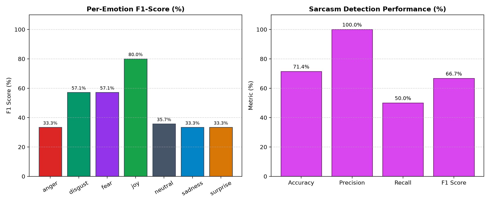

# P_098 — Model Evaluation & Performance Report

**Evaluation Date:** 2026-10-31T19:34:28.192644+00:00
**Test Set Size:** 35 Emotion Cases, 35 Sarcasm Cases
**Mode:** fallback; retrieval=tfidf; LLM=mock; Python=3.11.9
**Startup:** 427.2 ms (reported separately from warm latency)

---

## 1. Executive Summary

| Target Task | Primary Metric | Baseline Target | Measured Result | Status |
| :--- | :--- | :--- | :--- | :--- |
| **Emotion Classification** | **Macro-F1** | &ge; 0.700 | **0.471** | **FAILED** |
| **Emotion Classification** | **Accuracy** | &ge; 70.0% | **45.7%** | **FAILED** |
| **Emotion Classification** | **Weighted-F1**| &ge; 0.700 | **0.471** | **FAILED** |
| **Sarcasm Detection** | **F1 Score** | &ge; 0.650 | **0.667** | **PASSED** |
| **Inference Latency** | **Mean Latency** | < 150 ms (CPU) | **6.3 ms** | **PASSED** |

---

## 2. Per-Class Emotion Breakdown

| Emotion Label | Precision | Recall | F1-Score | Support |
| :--- | :---: | :---: | :---: | :---: |
| **Anger** | 1.000 | 0.200 | 0.333 | 5 |
| **Disgust** | 1.000 | 0.400 | 0.571 | 5 |
| **Fear** | 1.000 | 0.400 | 0.571 | 5 |
| **Joy** | 0.800 | 0.800 | 0.800 | 5 |
| **Neutral** | 0.217 | 1.000 | 0.357 | 5 |
| **Sadness** | 1.000 | 0.200 | 0.333 | 5 |
| **Surprise** | 1.000 | 0.200 | 0.333 | 5 |

**Macro Average:** Precision: 0.860 &bull; Recall: 0.457 &bull; **F1: 0.471**

---

## 3. Sarcasm Detection Metrics

- **Accuracy:** 71.4%
- **Precision:** 1.000
- **Recall:** 0.500
- **F1 Score:** 0.667

*Sarcasm policy:* Detected irony is flagged and can redistribute emotion scores toward anger/disgust. This is a heuristic and may be wrong.

---

## 4. Latency Benchmarks (CPU Inference)

- **Mean Pipeline Latency:** `6.3 ms`
- **95th Percentile Latency:** `10.5 ms`

Latency measures the warm pipeline including template rationale, excluding startup, HTTP and persistence. Memory usage is not measured by this script. This small curated sample does not establish general accuracy.

---

## 5. Visual Performance Charts

## Run verification

Every hybrid case must use both transformers and embedding retrieval, or the evaluator aborts.

Parallel inference: True. Calibration profile: temperature_scaled.

Actual backend counts: `{'emotion_model_heuristic': 70, 'sarcasm_model_heuristic': 70, 'retrieval_rag_tfidf': 70}`. Confidence methods: `{'uncalibrated_fusion': 70}`.
